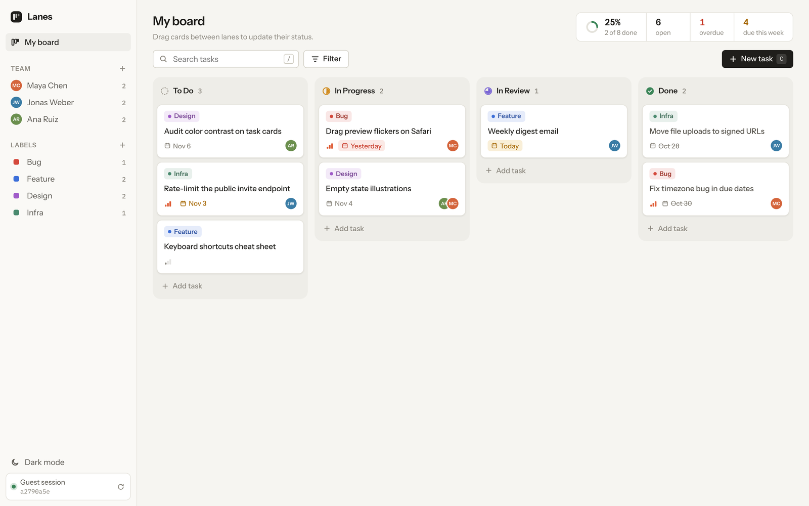

# Lanes

A Kanban board for small teams. React + TypeScript on the front, Supabase (Postgres, anonymous auth, RLS, realtime) behind it.

**Live:** https://lanes-xi.vercel.app



## What it does

- Four lanes (To Do, In Progress, In Review, Done) with drag and drop between and within them. Mouse, touch and keyboard (Space to pick up, arrows to move, Space/Enter to drop).
- A guest account is created silently on first visit (Supabase anonymous sign-in). Every row is owned by that user and locked down with RLS.
- Task detail panel with inline editing, comments and an activity timeline.
- Team members with colored avatars, multiple assignees per task.
- Labels, filtering by priority / assignee / label / due date, and title search.
- Due date badges (overdue, today, soon) and a small summary in the header.
- Light and dark themes, works on phones.

Keyboard: `C` new task, `/` search, `Esc` closes panels.

## Running it locally

You need Node 20+ and a free Supabase project.

1. **Database.** In the Supabase dashboard open *SQL Editor*, paste the contents of [`supabase/schema.sql`](supabase/schema.sql) and run it.
2. **Anonymous sign-ins.** *Authentication → Sign In / Providers → Allow anonymous sign-ins* → on.
3. **Env.**
   ```bash
   cp .env.example .env.local
   # fill in Project URL and the anon / publishable key (Project Settings → API)
   ```
4. **Run.**
   ```bash
   npm install
   npm run dev
   ```

`npm test` runs the unit tests for the board logic (ordering, filters, due dates). `npm run build` type-checks and builds.

## Deploying

Vercel: import the repo, framework preset *Vite*, add `VITE_SUPABASE_URL` and `VITE_SUPABASE_ANON_KEY` as environment variables, deploy. `vercel.json` already rewrites routes to `index.html`.

Only the public anon key is used in the browser. The service role key is never needed.

## Layout

```
supabase/schema.sql      tables, triggers, RLS policies, realtime
src/lib/                 api calls, types, pure board/date helpers (+ tests)
src/state/               board store (optimistic updates, realtime), toasts
src/components/          UI
src/styles/              tokens + component styles, no CSS framework
```

## Notes on a few decisions

- **Ordering.** Each task has a float `position`. A drop takes the midpoint of its new neighbours, so moving a card is one `UPDATE` on one row.
- **Activity log is written by Postgres triggers**, not the client. The table has no insert policy, so the browser can read its history but can't fake it.
- **Child rows reference `(task_id, user_id)`** with a composite foreign key. Even with a broken policy, a comment or label link can't be attached to someone else's task.
- **Optimistic UI.** Moves and edits apply instantly and roll back with a toast if the write fails. Realtime echoes for rows with a write still in flight are ignored so cards don't jump back.
